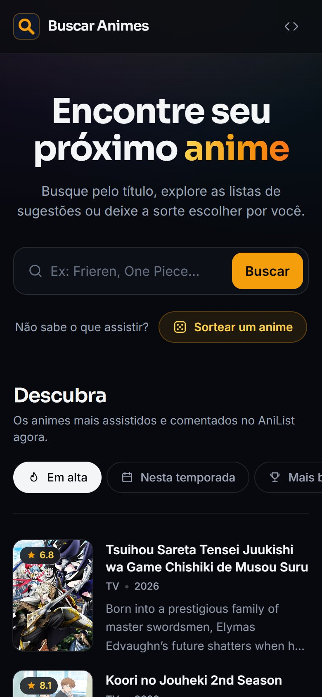
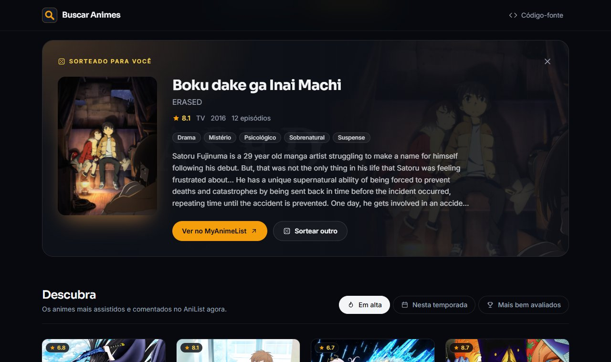
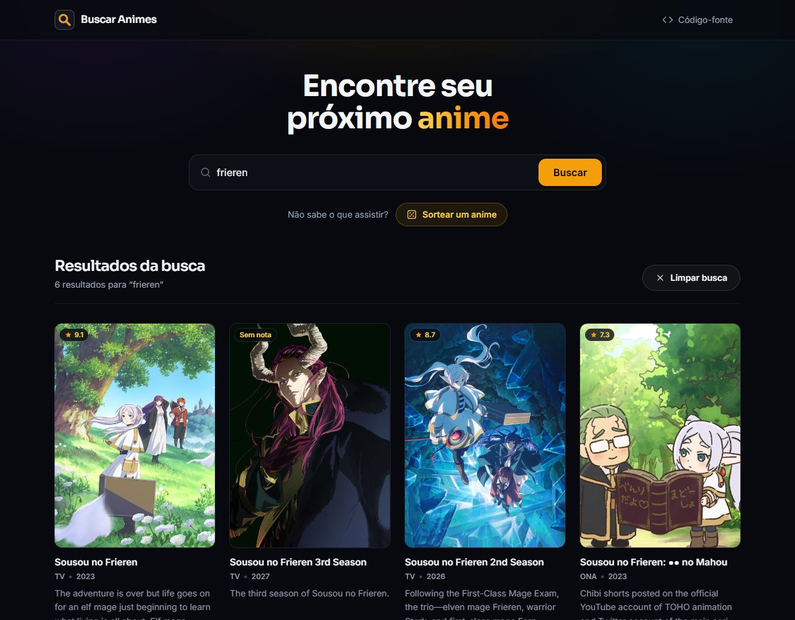
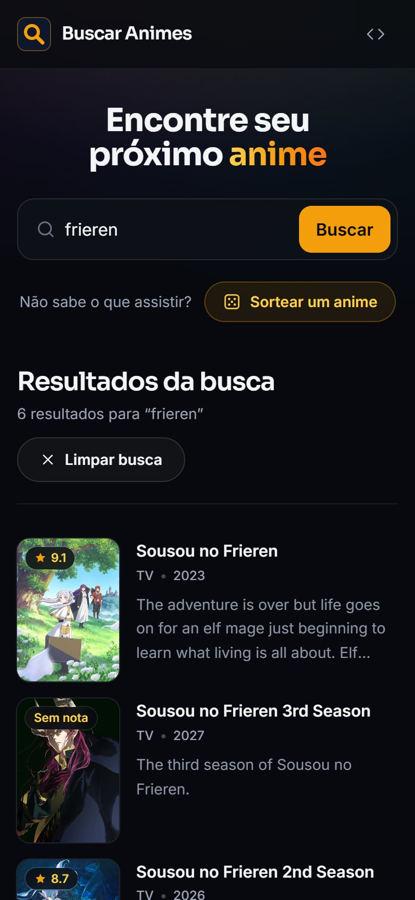

# Buscar Animes

[](https://github.com/gabrielrizzoo/Buscar-Animes/actions/workflows/ci.yml)


Aplicação web para encontrar o próximo anime para assistir: busque pelo nome, explore listas de sugestões (em alta, da temporada e mais bem avaliados) ou sorteie um anime quando não souber o que ver. Os dados vêm da [API GraphQL do AniList](https://docs.anilist.co/), e cada anime leva à sua página no [MyAnimeList](https://myanimelist.net/) (ou no AniList, quando o anime não está no MyAnimeList).

**Demonstração:** <https://buscar-animes.vercel.app>

<p align="center">
  
  &nbsp;
  
</p>

## Funcionalidades

- **Busca por nome** pelo botão "Buscar" ou pela tecla Enter, só com animes e sem conteúdo adulto (`isAdult: false`).
- **Sugestões sem precisar buscar:** a seção "Descubra" abre com a lista **Em alta** e tem abas para **Nesta temporada** (os mais populares da temporada atual, como a de outubro de 2026) e **Mais bem avaliados**. Cada lista tem 12 animes por vez e o botão "Carregar mais".
- **Sorteio ("Não sabe o que assistir?"):** o botão "Sortear um anime" escolhe um título entre os 1.000 mais populares do AniList com nota acima de 7 e mostra um destaque com capa, banner, título em inglês, nota, formato, ano, episódios, gêneros traduzidos e sinopse, além dos botões "Ver no MyAnimeList" e "Sortear outro".
- **Cards em formato de pôster** com capa, nota (de 0 a 10), título, formato (TV, Filme, OVA...), ano e sinopse resumida. O card inteiro abre a página do anime, e a sombra ao passar o mouse usa a cor predominante da capa.
- **Busca na URL** (`?q=naruto`): dá para compartilhar o link de uma busca, e os botões voltar/avançar do navegador refazem as buscas anteriores. O botão "Limpar busca" volta para as sugestões sem recarregá-las.
- **Estados de interface** para carregamento (skeleton), termo vazio, nenhum resultado e erros, com mensagens específicas para tempo esgotado (10 s), limite de requisições (HTTP 429, informando quanto tempo esperar), instabilidade do serviço (HTTP 5xx), falha de conexão e resposta inesperada, além do botão "Tentar novamente".
- **Capa substituta** quando o anime não tem imagem ou ela não carrega, e capas menores no celular (`srcset`).
- **Acessibilidade:** landmarks semânticos, regiões de status lidas por leitores de tela, abas de sugestões com `aria-pressed`, links com nome descritivo, foco visível, foco levado ao anime sorteado, navegação completa pelo teclado e respeito à preferência de movimento reduzido (`prefers-reduced-motion`).
- **Layout responsivo:** lista compacta no celular e grade de 3 a 4 colunas de pôsteres em telas maiores, de 320 px até telas largas.

<details>
<summary>Sorteio e resultados de busca</summary>



<p align="center">
  
  &nbsp;
  
</p>

</details>

## Tecnologias

| Ferramenta                                                                              | Uso no projeto                                                        |
| --------------------------------------------------------------------------------------- | --------------------------------------------------------------------- |
| [React 19](https://react.dev/)                                                          | Interface declarativa em componentes                                  |
| [TypeScript](https://www.typescriptlang.org/)                                           | Tipagem da resposta da API, que tem vários campos que podem ser nulos |
| [Vite 8](https://vite.dev/)                                                             | Servidor de desenvolvimento e build de produção                       |
| [Tailwind CSS 4](https://tailwindcss.com/)                                              | Estilos utilitários e tokens de tema (`@theme`)                       |
| [Vitest](https://vitest.dev/) + [Testing Library](https://testing-library.com/) + jsdom | Testes de unidade, de hook e de componentes                           |
| [Oxlint](https://oxc.rs/) e [Prettier](https://prettier.io/)                            | Lint e formatação (com ordenação automática das classes Tailwind)     |
| GitHub Actions                                                                          | Lint, formatação, testes e build a cada push e pull request           |
| [Vercel](https://vercel.com/)                                                           | Hospedagem                                                            |

Não há bibliotecas de roteamento, de estado global, de requisições ou de GraphQL: o app tem uma única tela e poucas consultas fixas, então `useReducer` + `fetch` resolvem o necessário.

## Decisões técnicas

- **Um hook para todas as listas.** A busca e as listas de sugestões usam o mesmo [`useAnimeList`](src/hooks/useAnimeList.ts), que recebe a função que busca cada página. Ele cuida de carregamento, erros, "Carregar mais" e cancelamento, e cada lista mantém o próprio estado: limpar a busca mostra de novo as sugestões já carregadas, sem nova requisição.
- **A última requisição sempre vence.** Cada requisição usa um `AbortController`. Uma nova busca, a troca de aba, o "Carregar mais", um novo sorteio ou a saída da tela cancelam a requisição anterior, e respostas atrasadas são descartadas.
- **Sorteio com uma única requisição.** A consulta do sorteio pede uma página com um único anime (`perPage: 1`) de uma lista ordenada por popularidade; sortear o número da página (de 1 a 1.000) é sortear o anime ([`anilist.ts`](src/services/anilist.ts)). Durante um novo sorteio, o anime anterior continua na tela, esmaecido, para a troca não piscar ([`useRandomAnime.ts`](src/hooks/useRandomAnime.ts)).
- **Sugestões com curadoria.** As listas e o sorteio aparecem sem a pessoa ter pedido nada, então aceitam só séries, filmes e ONAs e excluem o gênero ecchi. A lista "Mais bem avaliados" exige mais de 10 mil usuários no AniList, para evitar títulos com nota alta e poucos votos. A busca por nome não tem esses filtros.
- **Uma consulta por lista.** O AniList trata variáveis nulas como filtro (por exemplo, "animes sem temporada"), em vez de ignorá-las, por isso cada lista tem a própria consulta GraphQL, e só a da temporada recebe `season` e `seasonYear`.
- **Temporada pelo mês de início.** A temporada atual é calculada pela data ([`season.ts`](src/utils/season.ts)) e aparece como "temporada de outubro de 2026", porque "outono" e "primavera" se invertem no Brasil.
- **Consulta GraphQL com `fetch`.** Cada consulta é um `POST` com a query e as variáveis, sem cliente GraphQL. O serviço tem timeout próprio de 10 segundos, combinado com o cancelamento externo sem depender de `AbortSignal.any`, que não existe no Safari anterior ao 17.4.
- **Dados validados na entrada.** A resposta passa por uma normalização que trata campos ausentes, converte a nota de 0–100 para 0–10, traduz o formato e os gêneros, aceita apenas imagens `https`, cores no formato `#rrggbb` (a cor vai para um atributo `style`) e links do MyAnimeList ou do AniList, o que bloqueia URLs como `javascript:` ([`normalizeAnime.ts`](src/utils/normalizeAnime.ts)). A sinopse do AniList pode trazer `<br>` e `<i>`; ela vira texto puro antes de ser exibida ([`plainText.ts`](src/utils/plainText.ts)). Todo texto é renderizado pelo React como texto, e o lint proíbe `dangerouslySetInnerHTML`.
- **Erros tipados** (`ApiHttpError`, `ApiResponseError`, `RequestTimeoutError`) traduzidos em mensagens claras para o usuário ([`searchErrors.ts`](src/utils/searchErrors.ts)).
- **Visual em tokens.** O tema escuro neutro, com o âmbar reservado para ações e destaques, está definido como tokens do Tailwind em [`index.css`](src/index.css), com as fontes Sora (títulos) e Inter (texto). As cores ficam por conta das capas: a sombra dos cards e o brilho do destaque usam a cor predominante de cada capa. Os fundos usam só gradientes, sem filtros de blur pesados, e os ícones são SVGs próprios, sem biblioteca externa ([`Icon.tsx`](src/components/Icon.tsx)).
- **Card inteiro clicável sem links duplicados.** O link do título se estende sobre o card, então o clique funciona em qualquer ponto, mas o leitor de tela ouve um único link por anime.

## Estrutura

```text
src/
├── components/   # Header, Hero, SearchForm, RandomSpotlight, DiscoverSection, SearchResults, AnimeGrid, AnimeCard, Icon...
├── hooks/        # useAnimeList (busca e sugestões) e useRandomAnime (sorteio)
├── services/     # anilist.ts: consultas GraphQL, timeout e erros da API
├── types/        # Tipos da resposta do AniList e do modelo exibido
├── utils/        # Normalização, texto puro, temporada, mensagens de erro, formatação e URL
├── test/         # Configuração e dados de teste
├── App.tsx
├── main.tsx
└── index.css     # Tailwind, tokens de tema e estilos base
```

## Como executar localmente

Pré-requisitos: [Node.js](https://nodejs.org/) 24 LTS (versão indicada em `.nvmrc` e no campo `engines` do `package.json`) e npm.

```bash
git clone https://github.com/gabrielrizzoo/Buscar-Animes.git
cd Buscar-Animes
npm install
npm run dev
```

Abra o endereço exibido no terminal (por padrão, <http://localhost:5173>). Não há variáveis de ambiente nem chave de API: as consultas públicas do AniList não exigem autenticação.

## Scripts

| Comando                | O que faz                                                       |
| ---------------------- | --------------------------------------------------------------- |
| `npm run dev`          | Inicia o servidor de desenvolvimento                            |
| `npm run build`        | Verifica os tipos (`tsc`) e gera o build de produção em `dist/` |
| `npm run preview`      | Serve o build de produção localmente                            |
| `npm test`             | Executa os testes uma vez                                       |
| `npm run test:watch`   | Executa os testes em modo observação                            |
| `npm run lint`         | Analisa o código com Oxlint                                     |
| `npm run format`       | Formata os arquivos com Prettier                                |
| `npm run format:check` | Confere a formatação sem alterar arquivos                       |

## Testes

Os testes usam Vitest, Testing Library e uma API do AniList simulada, então não dependem da internet. Eles cobrem:

- o corpo de cada consulta GraphQL (busca, listas de sugestões com a temporada atual e sorteio, incluindo a página sorteada) e cada tipo de erro (HTTP, limite de requisições, JSON inválido, erro do GraphQL, falha de rede, timeout e cancelamento);
- a normalização dos dados, incluindo campos ausentes, conversão de nota, formatos, gêneros, título em inglês, cores, links, URLs inseguras e a limpeza da sinopse;
- o cálculo da temporada atual;
- os hooks: lista concorrente (a mais recente vence), "Carregar mais", nova tentativa após erro, cancelamento ao desmontar, e o sorteio mantendo o anime anterior durante um novo sorteio;
- os componentes e o fluxo completo: lista "Em alta" ao abrir, troca de abas, "Carregar mais" nas sugestões, sorteio com detalhes, "Sortear outro", fechamento e foco, busca com Enter, skeleton, URL e título da página, botão voltar do navegador, "Limpar busca", termo vazio, nenhum resultado, erros com nova tentativa e foco do teclado.

```bash
npm test
```

## Build e publicação

`npm run build` gera os arquivos estáticos em `dist/`. O deploy é feito pela Vercel, configurada em [`vercel.json`](vercel.json) (preset Vite, saída em `dist/`). O workflow [`ci.yml`](.github/workflows/ci.yml) roda lint, verificação de formatação, testes e build em cada pull request e em cada push na `main`.

## Limitações conhecidas

- **Limite de requisições do AniList.** A API está temporariamente limitada a 30 requisições por minuto (normalmente são 90). Abrir a página, trocar de aba, buscar, carregar mais e sortear usam uma requisição cada. Ao estourar o limite, o app avisa quanto tempo esperar e permite tentar de novo.
- **Sem contagem total de resultados.** O AniList não informa um total confiável para buscas, então o app mostra quantos resultados já foram carregados e se há mais páginas.
- **Idioma dos dados.** Títulos aparecem em japonês romanizado (o título em inglês aparece só no destaque do sorteio), e as sinopses vêm em inglês, sem tradução.
- **Sorteio limitado aos populares.** O sorteio considera os 1.000 animes mais populares com nota acima de 7, o que deixa de fora títulos pouco conhecidos.
- **Sem filtros.** Ainda não há filtros por formato, gênero ou ordenação na busca, nem sorteio por gênero.

## Próximos passos possíveis

- Filtros por formato, gênero e ordenação, usando os argumentos `format`, `genre` e `sort` da consulta `Page.media` do AniList, e sorteio por gênero.
- Página ou modal de detalhes do anime, com personagens e episódios.
- Opção de exibir títulos em inglês nos cards.

## Histórico

Este projeto nasceu em 2024 na **Imersão Dev Front-End com Google Gemini, da Alura**. A primeira versão buscava em uma lista fixa de três animes guardada em `dados.js` e servia para praticar lógica e manipulação do DOM.

Em 2026, o app passou a consultar a API Jikan (dados do MyAnimeList) e ganhou o visual escuro com efeito de vidro, ainda em HTML, CSS e JavaScript puros. Depois, uma auditoria corrigiu problemas de segurança e de comportamento (injeção de HTML, falta de timeout, buscas concorrentes e o resumo da sinopse), e a interface foi migrada para React, TypeScript e Tailwind CSS. A versão em JavaScript puro continua disponível no histórico do Git, na tag `v1-vanilla`.

Em outubro de 2026, a [API pública da Jikan foi descontinuada](https://github.com/jikan-me/jikan-rest/issues/613), e a busca passou a usar a API do AniList, junto com um redesign completo da interface. No mesmo mês vieram as listas de sugestões, o sorteio e um visual mais limpo, com as cores vindas das capas.

## Créditos

Desenvolvido por **Gabriel Rizzo**: [LinkedIn](https://www.linkedin.com/in/gabriel-rizzo-352052266/).

Dados fornecidos pelo [AniList](https://anilist.co/), com links para o [MyAnimeList](https://myanimelist.net/). Este projeto é independente e não tem vínculo com nenhum dos dois serviços.

Sugestões e correções são bem-vindas por meio de issues e pull requests.
