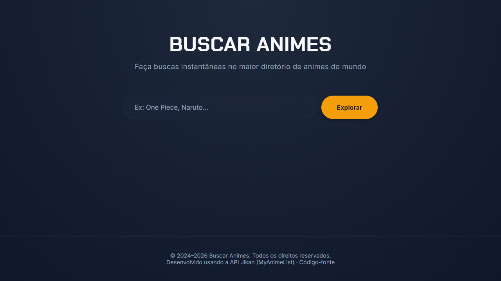
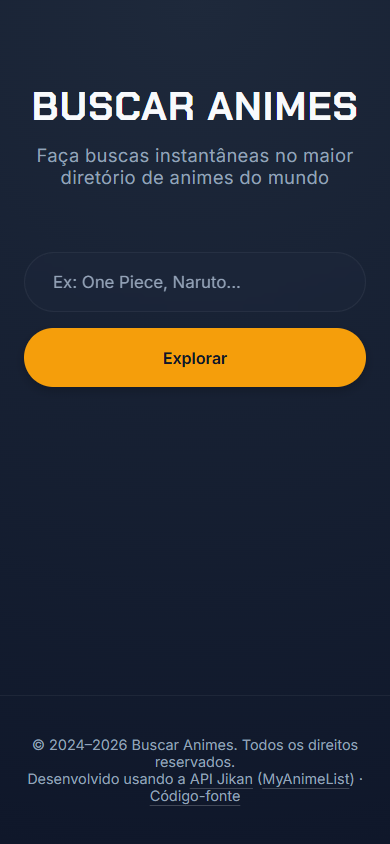
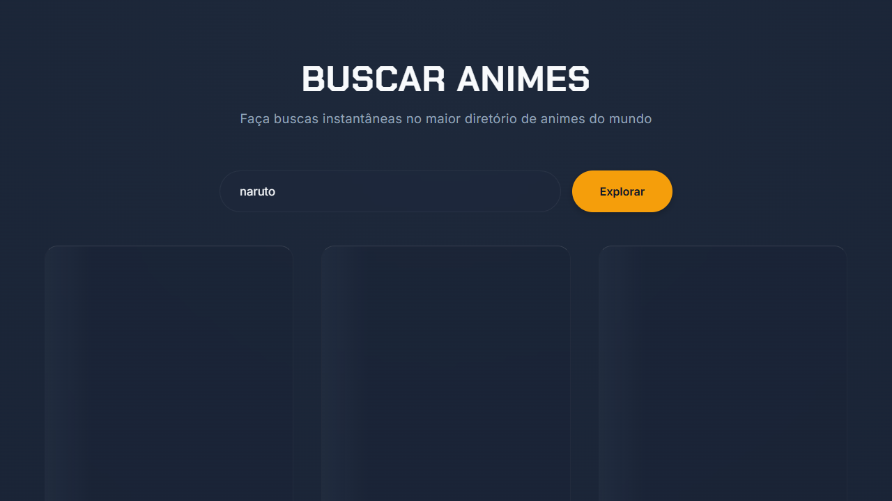

# Buscar Animes

[](https://github.com/gabrielrizzoo/Buscar-Animes/actions/workflows/ci.yml)


Aplicação web para buscar animes pelo nome e ver capa, tipo, ano, nota e sinopse de cada resultado. Os dados vêm do [MyAnimeList](https://myanimelist.net/), consultados pela [API Jikan](https://jikan.moe/).

**Demonstração:** <https://buscar-animes.vercel.app>

<p align="center">
  
  &nbsp;
  
</p>

## Funcionalidades

- **Busca por nome** pelo botão "Explorar" ou pela tecla Enter, com conteúdo adulto filtrado pela própria API (`sfw=true`).
- **Cards de resultado** com capa, título, tipo, ano de lançamento, nota, sinopse resumida em quatro linhas e link para a página do anime no MyAnimeList.
- **Paginação** com 12 resultados por vez e botão "Carregar mais".
- **Busca na URL** (`?q=naruto`): dá para compartilhar o link de uma busca, e os botões voltar/avançar do navegador refazem as buscas anteriores.
- **Estados de interface** para carregamento (skeleton), termo vazio, nenhum resultado e erros, com mensagens específicas para tempo esgotado (10 s), limite de requisições (HTTP 429), instabilidade do serviço (HTTP 5xx), falha de conexão e resposta inesperada, além do botão "Tentar novamente".
- **Capa substituta** quando o anime não tem imagem ou ela não carrega.
- **Acessibilidade:** landmarks semânticos, região de status lida por leitores de tela, links com nome descritivo, foco visível, navegação completa pelo teclado e respeito à preferência de movimento reduzido (`prefers-reduced-motion`).
- **Layout responsivo** de 320 px até telas largas.

<details>
<summary>Estado de carregamento</summary>



</details>

## Tecnologias

| Ferramenta                                                                              | Uso no projeto                                                        |
| --------------------------------------------------------------------------------------- | --------------------------------------------------------------------- |
| [React 19](https://react.dev/)                                                          | Interface declarativa em componentes                                  |
| [TypeScript](https://www.typescriptlang.org/)                                           | Tipagem da resposta da API, que tem vários campos que podem ser nulos |
| [Vite 8](https://vite.dev/)                                                             | Servidor de desenvolvimento e build de produção                       |
| [Tailwind CSS 4](https://tailwindcss.com/)                                              | Estilos utilitários e tokens de tema (`@theme`)                       |
| [Vitest](https://vitest.dev/) + [Testing Library](https://testing-library.com/) + jsdom | Testes de unidade, de hook e de componentes                           |
| [Oxlint](https://oxc.rs/) e [Prettier](https://prettier.io/)                            | Lint e formatação (com ordenação automática das classes Tailwind)     |
| GitHub Actions                                                                          | Lint, formatação, testes e build a cada push e pull request           |
| [Vercel](https://vercel.com/)                                                           | Hospedagem                                                            |

Não há bibliotecas de roteamento, de estado global ou de requisições: o app tem uma única tela, e `useReducer` + `fetch` resolvem o necessário.

## Decisões técnicas

- **A última busca sempre vence.** Cada requisição usa um `AbortController`. Uma nova busca, o "Carregar mais" ou a saída da tela cancelam a requisição anterior, e respostas atrasadas são descartadas. Assim o resultado exibido sempre corresponde ao termo do campo de busca ([`useAnimeSearch.ts`](src/hooks/useAnimeSearch.ts)).
- **Timeout próprio de 10 segundos**, combinado com o cancelamento externo sem depender de `AbortSignal.any`, que não existe no Safari anterior ao 17.4 ([`jikan.ts`](src/services/jikan.ts)).
- **Dados validados na entrada.** A resposta da API passa por uma normalização que trata campos ausentes e aceita apenas capas `https` e links do MyAnimeList, o que bloqueia URLs como `javascript:` ([`normalizeAnime.ts`](src/utils/normalizeAnime.ts)). Todo texto é renderizado pelo React como texto, e o lint proíbe `dangerouslySetInnerHTML`.
- **Erros tipados** (`JikanHttpError`, `JikanResponseError`, `RequestTimeoutError`) traduzidos em mensagens claras para o usuário ([`searchErrors.ts`](src/utils/searchErrors.ts)).
- **Identidade visual preservada.** Cores, fontes e o efeito de vidro da versão original viraram tokens do Tailwind em [`index.css`](src/index.css).

## Estrutura

```text
src/
├── components/   # Header, SearchForm, SearchResults, AnimeCard, CoverImage, LoadMore...
├── hooks/        # useAnimeSearch: estado da busca, paginação e cancelamento
├── services/     # jikan.ts: requisição, timeout e erros da API
├── types/        # Tipos da resposta da Jikan e do modelo exibido
├── utils/        # Normalização, mensagens de erro, formatação e sincronização com a URL
├── test/         # Configuração e dados de teste
├── App.tsx
├── main.tsx
└── index.css     # Tailwind, tokens de tema e estilos base
```

## Como executar localmente

Pré-requisitos: [Node.js](https://nodejs.org/) 24 LTS (versão indicada em `.nvmrc`; o mínimo aceito é 22.12) e npm.

```bash
git clone https://github.com/gabrielrizzoo/Buscar-Animes.git
cd Buscar-Animes
npm install
npm run dev
```

Abra o endereço exibido no terminal (por padrão, <http://localhost:5173>). Não há variáveis de ambiente nem chave de API: a Jikan é pública.

## Scripts

| Comando                | O que faz                                                       |
| ---------------------- | --------------------------------------------------------------- |
| `npm run dev`          | Inicia o servidor de desenvolvimento                            |
| `npm run build`        | Verifica os tipos (`tsc`) e gera o build de produção em `dist/` |
| `npm run preview`      | Serve o build de produção localmente                            |
| `npm test`             | Executa os testes uma vez                                       |
| `npm run test:watch`   | Executa os testes em modo observação                            |
| `npm run lint`         | Analisa o código com Oxlint                                     |
| `npm run format`       | Formata os arquivos com Prettier                                |
| `npm run format:check` | Confere a formatação sem alterar arquivos                       |

## Testes

Os testes usam Vitest, Testing Library e uma API Jikan simulada, então não dependem da internet. Eles cobrem:

- a montagem da URL da requisição e cada tipo de erro (HTTP, JSON inválido, falha de rede, timeout e cancelamento);
- a normalização dos dados, incluindo campos ausentes e URLs inseguras;
- o hook de busca: busca concorrente (a mais recente vence), "Carregar mais", nova tentativa após erro e cancelamento ao desmontar;
- os componentes e o fluxo completo: Enter, skeleton, resultados, URL e título da página, botão voltar do navegador, termo vazio, nenhum resultado, erro com nova tentativa, paginação e foco do teclado.

```bash
npm test
```

## Build e publicação

`npm run build` gera os arquivos estáticos em `dist/`. O deploy é feito pela Vercel, configurada em [`vercel.json`](vercel.json) (preset Vite, saída em `dist/`). O workflow [`ci.yml`](.github/workflows/ci.yml) roda lint, verificação de formatação, testes e build em cada pull request e em cada push na `main`.

## Limitações conhecidas

- **Dependência da API Jikan.** É um serviço gratuito e não oficial, com limite de 3 requisições por segundo e 60 por minuto, e que pode ficar fora do ar. Nesses casos o app mostra uma mensagem e permite tentar de novo, mas não tem fonte de dados alternativa.
- **Idioma dos dados.** Títulos e sinopses vêm do MyAnimeList como estão, geralmente em inglês ou em japonês romanizado, sem tradução.
- **Sem filtros.** A busca usa apenas o parâmetro `q` da API; filtros por tipo, gênero e ordenação ainda não foram implementados.

## Próximos passos possíveis

- Filtros por tipo e ordenação, usando os parâmetros `type`, `order_by` e `sort` da Jikan.
- Lista de favoritos salva no navegador.
- Página ou modal de detalhes do anime (`GET /anime/{id}`).

## Histórico

Este projeto nasceu em 2024 na **Imersão Dev Front-End com Google Gemini, da Alura**. A primeira versão buscava em uma lista fixa de três animes guardada em `dados.js` e servia para praticar lógica e manipulação do DOM.

Em 2026, o app passou a consultar a API Jikan e ganhou o visual escuro com efeito de vidro, ainda em HTML, CSS e JavaScript puros. Na etapa seguinte, uma auditoria corrigiu problemas de segurança e de comportamento (injeção de HTML, falta de timeout, buscas concorrentes e o resumo da sinopse), e a interface foi migrada para React, TypeScript e Tailwind CSS. A versão em JavaScript puro continua disponível no histórico do Git, na tag `v1-vanilla`.

## Créditos

Desenvolvido por **Gabriel Rizzo**: [LinkedIn](https://www.linkedin.com/in/gabriel-rizzo-352052266/).

Dados fornecidos pelo [MyAnimeList](https://myanimelist.net/) por meio da [API Jikan](https://jikan.moe/). Este projeto não tem vínculo com nenhum dos dois serviços.

Sugestões e correções são bem-vindas por meio de issues e pull requests.
